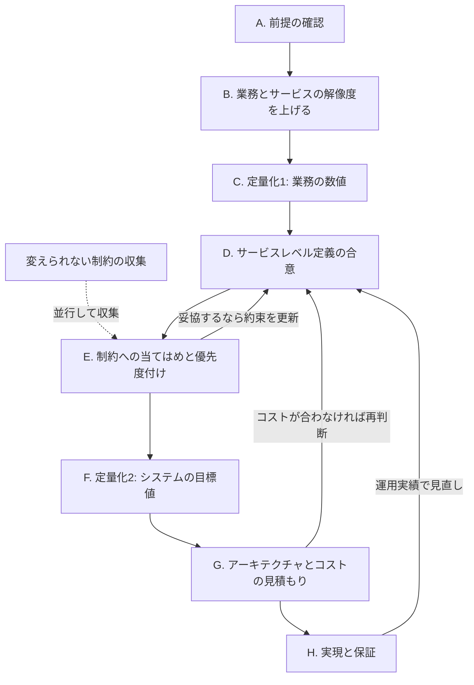

[秋のブログ週間2026](/articles/20261026a/) の5本目です。

前回の [非機能はなぜ必要なのか](/articles/20261030a/) の続編です。前回は社内の非機能要件ガイドラインを読んで感じた違和感をエッセイとして書きましたが、今回はその考え方を、実務で使える形に整理し直したものです。

## 本記事の位置づけ

本記事は、非機能を「システム開発者の目線」ではなく「事業者（サービス提供者）の目線」で捉え直し、考え方の軸を整理するものである。

- 扱うこと: 非機能とは何か、何のために決めるのか、どの順番で誰が決めるのか、何をもって保証とするのか
- 扱わないこと: 個々の品質特性の設計手法、テスト技法の詳細、フレームワーク（IPA 非機能要求グレード等）の項目解説
- 前提: 提案やグラウンドデザイン（GD）などの上流検討で、大枠のやりたいことが決まっていることを前提とする。整理されていない場合の補い方は「前提条件」の章で述べる

## 本記事の立場

### 現状の違和感

非機能は「技術目線の仕様」として扱われることが多い。性能・可用性・セキュリティといった品質特性の項目を並べ、構築側が水準を埋め、テストで担保する。この捉え方には次の弱点がある。

- サービスレベルへの意識が薄い。項目を埋めること自体が目的になりやすい
- 非機能が「サービスの水準を決めるもの」だという意識が薄い。結果として、決める主体が構築側に寄る
- 非機能を「機能要件から導出できない暗黙の期待を可視化するもの」と捉えると、構築側が期待を拾い集める受け身の構図になる
- 「保証」の対象がシステム（設計とテスト）に閉じ、提供中のサービスが約束を守っているかが問われない

### 本記事の立場

> 非機能とは、利用者に対して「このサービスをどこまで信頼してよいか」を約束する設計である。
> したがって、非機能はほぼサービスレベル設計と同じものであり、出発点は技術ではなく業務である。

約束する主体は事業者であり、約束の相手は利用者である。構築側（アーキテクト）は、その約束を数値に翻訳し、守れる仕組みを作り、守れていることを示す役割を担う。

### 二つの捉え方の比較

| 観点 | 技術目線の非機能 | 事業者目線の非機能（本記事） |
| --- | --- | --- |
| 問いの起点 | どの品質特性を、どの水準にするか | 誰に、何を、どの程度まで約束するか |
| 主語 | システム | サービスとその利用者 |
| 決める人 | 構築側が主導する | 事業者が決め、構築側が翻訳と助言をする |
| 水準の根拠 | フレームワーク、ベストプラクティス、類似事例 | 業務と事業の要求（フレームワークは抜け漏れ確認に使う） |
| 保証の対象 | 作ったシステムが基準を満たすこと | 提供中のサービスが約束を守り続けること |
| 終わり | リリース（非機能テストの合格） | サービスを提供している限り続く |

## 非機能とは何か

### 機能と非機能

- 機能: サービスが何をできるか
- 非機能: そのサービスを、どの水準で提供すると約束するか

| 区分 | EC サイトでの例 |
| --- | --- |
| 機能 | 商品を購入できる |
| 非機能（技術目線の書き方） | 購入 API のレスポンスは 3 秒以内。稼働率 99.9% |
| 非機能（約束としての書き方） | セール開始直後のピーク時でも、購入手続きの 99% が 3 秒以内に完了する。購入できない時間は月 45 分以内に抑え、超えた場合は原因と再発防止策を公表する |

約束としての書き方は、利用者が体感できる言葉で、どの場面で、どの程度、守れなかったらどうするかまでを含む。技術的な目標値は、この約束を守るために後から導出するものである。

### 「暗黙の期待」ではなく「合意する約束」

「いつでも使えて当然」といった暗黙の期待を引き出すことは大切だが、それは入力の1つにすぎない。サービスレベルはサービス設計そのものであり、事業者が判断して決め、関係者と合意すべき要件である。

| | 例 | 性質 |
| --- | --- | --- |
| 期待 | 24 時間止まらないでほしい | 利用者や業務担当者の願望。コストの裏付けがない |
| 約束 | 平日 8〜20 時の受付時間帯は月 99.9% で提供する。夜間は計画停止を設ける | 事業判断（利用者への影響とコスト）を経て決めた設計 |

期待を拾うだけでは「期待が出てこなければ要件もない」ことになる。約束として設計するなら、期待が出てこない項目も事業者が判断しなければならない。

### SLI・SLO・SLA

| 用語 | 意味 | 例 |
| --- | --- | --- |
| SLI（Service Level Indicator） | サービスの水準を測る指標 | 購入リクエストのうち、3 秒以内に成功した割合 |
| SLO（Service Level Objective） | 指標に対する目標値 | 月間で 99.5% 以上 |
| SLA（Service Level Agreement） | 対外的な約束。未達時の扱いを含む | 月間 99.0% を下回った場合は利用料の一部を返金する |

社内向けシステムでも SLO の考え方はそのまま使える。約束の相手が社内の業務部門になるだけである。

### 利用者から見たサービスレベルの観点

品質特性の一覧から始めるのではなく、利用者の問いから始め、対応する技術的な観点に落とす。

| 利用者の問い | 対応する主な技術的観点 |
| --- | --- |
| 使いたいときに使えるか | 可用性、提供時間帯、計画停止 |
| 待たされないか | 性能、拡張性 |
| 預けたデータは正しく、失われないか | データの整合性、バックアップ、RPO |
| 止まったら、どれくらいで戻るか。どう知らされるか | RTO、縮退運転、障害時の連絡 |
| 安心して使えるか | セキュリティ、プライバシー保護 |
| 困ったときに助けてもらえるか | サポート窓口、問い合わせ対応時間 |
| 事業の変化についてきてくれるか | 保守性、拡張性、移行性 |

運用やサポートの水準もサービスレベルの一部である。システムの品質特性だけではサービスレベルは語れない。

## 前提条件 ― 着手時点で何が整理されているか

サービスレベル設計の精度は、着手時点で業務とサービスがどこまで整理されているかで決まる。最初に入口の状態を確認し、不足しているものを関係者と共有する。

| 確認項目 | 確認すること | 不足しているときの対応 |
| --- | --- | --- |
| 事業目標・KPI | 想定する利用者数、利用頻度、取扱件数、売上目標 | 企画書や事業計画から仮置きし、事業責任者に確認する |
| サービスの範囲 | 誰に、何を提供するサービスか | サービスの一文定義を作り、合意する |
| 関係者 | 利用者、業務担当者、意思決定者、運用者 | 関係者マップを作る |
| 業務フロー | 主要な業務の流れ、他業務・他システムとのつながり | 主要フローだけでも先に描く |
| 業務カレンダー・業務イベント | 繁忙期と閑散期、締め処理、決算、キャンペーン、年度切替など | 業務担当者と年間カレンダーを作る |
| 新規構築か現行刷新か | 刷新なら現行の実績値と障害履歴、新規なら事業計画上の見込み | 下記を参照 |
| 上流の検討の有無 | グラウンドデザイン（GD）や企画検討の成果物があるか | ない場合は、要件定義の提案時に仮説として補う |

新規構築でも数値は出せる。新規サービスであれば、企画段階で「どれだけの利用者に、どれくらい使ってほしいか」という KPI が定められているはずである。実態がそうなるかは別として、事業目標から逆算した数値は根拠が明確で、むしろ確度の高い前提になる。KPI が定まっていないなら、それ自体が事業上のリスクとして事業者に問い返すべき事項である。

上流の検討がない場合は、要件定義の提案時に仮説を立てて補うことになる。ただし、その時間は取れないことが多い。そのため、何が整理されていないかを A（前提の確認）で明示し、不足分を補う作業をあらかじめ計画に組み込んでおく。

## 目的 ― 何のためにサービスレベルを設計するか

### 要求: 何を約束するかを決める

- 利用者に何を、どの水準で約束するかを、業務の根拠とセットで決める
- 約束の水準がコストを決める。可用性や性能の水準は、インフラ構成、冗長化の範囲、運用体制、ひいてはランニングコストを左右する
- ランニングコストまで見積もれなければ、事業者は投資判断（決裁）ができない。サービスレベルが決まらないまま進めることは、予算の根拠がないまま進めることと同じである

### 実現: 約束を守れる形で作る

- 設計: アーキテクチャはサービスレベルから導出する。たとえば DR 対策の要否と方式は、サービスが止まったときの事業影響と、合意した RTO・RPO で決まる。サービスレベルがない状態では、アーキテクチャは何も決められない
- テスト: 提供を始める前に、約束した水準を満たせることを確認する

### 保証: 約束が守られていることを示し続ける

非機能テストの合格は「この水準を守れるはずだ」という提供前の確認にすぎない。保証すべき対象はシステムではなくサービスであり、保証はサービスを提供している間ずっと続く。

| 活動 | 確かめること | 時期 |
| --- | --- | --- |
| 設計レビュー | 約束を守れる設計になっているか | 設計時 |
| 非機能テスト | 約束した水準を、提供前に満たせるか | テスト時 |
| SLI の計測・監視 | 約束が実際に守られているか | 提供中、常時 |
| サービスレベルの定期報告 | 達成状況を事業者・利用者に示す | 提供中、定期（例: 月次） |
| 未達時の対応 | 原因の特定、改善、利用者への説明 | 未達・障害の発生時 |
| サービスレベルの見直し | 事業の変化に対して、約束の水準が今も妥当か | 定期、事業計画の変更時 |

保証の仕組み（何を測り、どこに報告し、未達時に誰が何をするか）も、サービスレベルの合意内容に含める。測り方が決まっていなければ、同じ実績を見ても達成か未達かの判断が食い違う。

SLO を下回らない範囲で許容できる失敗の量（エラーバジェット）を持つと、「新機能のリリースを優先するか、安定化を優先するか」を事業者と構築側が同じ物差しで判断できる。

社内向けシステムでは、業務部門を相手に SLI の計測と定期報告まで行う負荷が大きい場合もある。その場合は、止まると事業に響く重要な業務から適用し、測る指標を少数に絞って始める。

### 継承: 約束と根拠を引き継ぐ

合意したサービスレベルは、業務上の根拠とセットで残す。根拠が残っていれば、事業が変化したときに「約束を変えるべきか」「システムを変えるべきか」を判断できる。根拠のない数値だけが残ると、後任が過剰に、あるいは過小に作り込みかねない。

## 進め方

### 原則: 要望を先に数値にする

要望を数値にし、その後で制約に当てはめ、優先順位を決める。順番を逆にして制約を先に置くと、制約が議論の枠を決めてしまい、本来妥協しなくてよい要望をシステムの都合で諦めることになる。

要望は 2 段階で扱う。満たせなければサービスが成り立たない「絶対に外せない要望」を、まず B で定性的に押さえ、C で業務の数値にする。

ただし、法規制、全社ポリシー、決定済みの技術スタックといった「変えられない制約」は早めに集めておく。これは要望の検討を止めるためではなく、後の手戻りを防ぐための情報収集である。制約の収集は B・C と並行して進めるが、当てはめるのは要望を数値にした後の E とする。

### 全体の流れ

各ステップは一方通行ではない。後段で判明したことを受けて、サービスレベル定義（D）に戻って約束を更新する。

### 各ステップ

#### A. 前提の確認

「前提条件」の章のチェックリストで、着手時点で何が整理されているかを確認し、不足しているものとその補い方を関係者と共有する。

#### B. 業務とサービスの解像度を上げる

主体は業務担当者である。アーキテクトは並走して助言する。定性的でよいので、次を整理する。

- 誰が使うか: 利用者の区分と、区分ごとのおおよその人数
- 何のために使うか: 業務の目的。止まったとき、遅いとき、データを失ったときに業務で何が起きるか
- どの程度使うか: 利用の頻度と時間帯、繁忙期と閑散期、業務イベント（月末締め、決算、キャンペーン、年度切替など）

あわせて、満たせなければサービスが成り立たない「絶対に外せない要望」を定性的に押さえておく。C で数値にし、E で制約と突き合わせるときの軸になる。

業務イベントは、非機能だけでなく機能や制約にも結び付く。たとえば締め処理の時間枠は、バッチの処理時間やオンラインを止められるかどうかを決める。

業務の整理が完成するまで待つ必要はない。関係者と業務フロー、制約がおおよそ整理できた段階（感覚として 3 割程度）で、「この業務ならこのくらいの利用者になる」「こういうイベントがある」といった話ができる状態になる。そこから並行して次のステップを始める。

#### C. 定量化 第1段階: 業務の数値

業務の言葉のまま、数値にする。技術用語（TPS など）はまだ使わない。

| 業務の数値 | 問いかけの例 |
| --- | --- |
| 利用者数 | 利用者は何人か。3 年後には何人を見込むか |
| ピーク時の利用 | 一番混む時間帯に、何人が同時に操作しているか |
| 業務イベント時の件数 | 月末締めの日には、普段の何倍の件数を処理するか |
| 提供時間帯 | 業務は何時から何時まで行われるか。夜間や休日に使う人はいるか |
| 停止の許容範囲 | 何分止まると業務に支障が出るか。半日止まると何が起きるか |
| データ喪失の許容範囲 | 直近何時間分のデータなら再入力で取り戻せるか |

業務担当者が数値を出しにくい場合は、アーキテクトが事業計画や現行の実績から仮説を示し、「この想定で実態と合っているか」を確かめる。成果物は、業務と結び付いた基礎数値の一覧である。

#### D. サービスレベル定義の合意

業務の数値をもとに、利用者向けの約束としてサービスレベルを言葉にし、事業者と合意する。ここで合意するのは利用者向けの約束であり、技術的な目標値（TPS、構成など）ではない。

合意する内容は、末尾のサービスレベル定義シートを参照。最低限、次を含める。

- 対象のサービスと利用者
- 提供時間帯
- 何を測るか（SLI）と、目標値（SLO）
- 測り方（計算式、計測地点、集計期間）
- 守れなかったときの扱い（報告、改善、利用者への説明）
- その水準にした業務上の根拠

#### E. 制約への当てはめと優先度付け

合意したサービスレベルを、予算、スケジュール、規程、技術制約、外部依存（外部の認証基盤や連携先の SLA など）に当てはめる。収まらない場合は、要件を Must（満たせなければ事業が成り立たない）、Should（交渉の余地がある）、Want（余裕があれば実現する）に分けて調整する。

妥協するかどうかを決めるのは事業者である。構築側は「水準とコストの組合せ」と「妥協したときに利用者と業務に何が起きるか」を選択肢として示す。妥協した場合は、D に戻ってサービスレベル定義（約束）を更新する。システムの都合で黙って水準を下げてはならない。

| 妥協の例 | 利用者・業務への影響として示すこと |
| --- | --- |
| 夜間を計画停止にする | 夜間に使う利用者は何人いて、代替手段はあるか |
| 月末締めの日だけ応答が遅くなるのを許容する | 締め作業が何分延び、残業や後続業務にどう響くか |
| 復旧目標を 1 時間から 4 時間に緩める | 4 時間止まったとき、売上や取引先への影響はどれだけか |

#### F. 定量化 第2段階: システムの目標値

合意したサービスレベルを、システムの目標値に変換する。性能諸元（TPS、データ量）、稼働率、RTO・RPO、DR 方式、バックアップの頻度と保管期間などである。

変換の計算式は、業務の数値と結び付けて残す。

> ピーク時の同時利用者 1,000 人 × 10 秒に 1 回の操作 = 100 TPS
> 月末締めの日は通常の 3 倍の件数 → 300 TPS を上限として設計する

要件定義の段階で求める精度は、サービスレベルとコストの判断に効く範囲までとする。特に上限値（最大の利用者数、最大の件数）は必ず押さえる。

業務イベントは、構成、コスト、機能、制約のいずれかを変えるものまでを要件定義で扱う。判断に迷ったら「そのイベントを知らないままだと、アーキテクチャかコストが変わるか」を問う。変わるなら要件定義で数値にし、変わらないなら後続に回す。業務イベントごとの細かいボリュームを性能テストのシナリオにまで落とし込むのは、機能要件が具体化した後のテスト計画で行う。

#### G. アーキテクチャとコストの見積もり

サービスレベルから導出した目標値をもとに、アーキテクチャと、イニシャルコストおよびランニングコストを見積もる。サービスレベルの水準ごとに複数案（例: 高・標準・最低限）を示すと、事業者は水準とコストを比べて判断できる。コストが事業計画に合わなければ、D に戻って約束を見直す。

#### H. 実現と保証

設計、構築、非機能テストで「約束を守れる」ことを確認し、提供開始後は SLI の計測、定期報告、未達時の対応、見直しで「約束を守っている」ことを示し続ける（「保証」の節を参照）。運用の実績は、次のサービスレベル見直しの根拠になる。

## 役割分担

| 担い手 | 担うこと |
| --- | --- |
| 業務担当者（事業者側） | サービスの目的、利用者、業務フロー、業務イベントを、定性的にでも整理する。何を約束し、何を妥協するかを最終的に判断する |
| アーキテクト（構築側） | 業務の要望や業務ルールを数式にし、基礎数値として固める。基礎数値を業務と結び付けて事業者と合意する。技術的に可能なこととコストを助言する。合意した約束をシステムの目標値と実現方式に落とし込み、守れていることを示す仕組みを作る |
| 双方 | 互いに仮説を出し合い、検討を深める |

業務担当者は、まず「できる・できない」を脇に置き、どんなサービスにしたいかを考える。アーキテクトはその横で、技術的な実現性とコストを助言する。そのうえで、できる・できないを一緒に議論する。

## 仮説を置いて往復する

サービスレベル設計には、次の鶏と卵の問題がある。

- 業務側: 技術的に何が可能かわからないと、仕様を決められない
- 構築側: 何を実現したいのかわからないと、アーキテクチャを決められない

どちらかの完成を待っていては進まない。双方が仮説を置き、往復しながら確度を上げていく。

### 往復の進め方

- 業務の整理が 3 割程度進んだ時点で、並行してサービスレベルの仮説を置き始める
- 数値には確度を添えて扱う（仮置き、確度中、確定）。仮置きの値は幅を持たせ、確度が上がるにつれて狭める
- 確度の低い値を「確定」として約束しない。後から水準を下げる説明は、上げる説明よりはるかに難しい
- 仮説を覆すときは、事業前提の変化や実績との乖離といった理由を添えて説明する

### アーキテクチャの検討が先行する場合

リプレイスやデータ基盤の案件では、基盤の制約が決まらないとアプリの要件が煮詰まらないため、アーキテクチャの検討が業務・アプリの検討より先に始まりやすい。一方で、業務要件がまったく固まっていない状態では、サービスレベルも固められない。

アーキテクチャの検討が先行する場合も、次を守る。

- 先行して決めるのは方針レベルにとどめる
- 前提にしたサービスレベルの仮説（業務の数値の仮置き）を明示する
- 業務検討の結果で仮説を検証し直すことを、あらかじめ関係者と合意しておく

## 用語

| 用語 | 本記事での意味 |
| --- | --- |
| サービスレベル | 事業者が利用者に約束する、サービス提供の水準 |
| 基礎数値 | 利用者数、件数、ピーク、提供時間帯など、サービスレベルとシステム目標値の土台となる業務の数値 |
| 性能諸元 | 基礎数値から導出した、システムが処理すべき量（TPS、データ量など） |
| RTO（目標復旧時間） | 停止してから、サービスを再開するまでの目標時間 |
| RPO（目標復旧時点） | 障害時に、どの時点までのデータを取り戻すかの目標 |
| エラーバジェット | SLO を下回らない範囲で許容できる失敗の量 |
| 業務イベント | 月末締め、決算、キャンペーンなど、利用の量や性質が通常と変わる業務上の出来事 |

## サービスレベル定義シート（テンプレート）

| 項目 | 記入内容 | 記入例 |
| --- | --- | --- |
| 対象サービス | 約束の対象となるサービスや業務 | オンライン購入 |
| 利用者 | 約束の相手 | 一般会員（約 50 万人） |
| 提供時間帯 | サービスを提供する時間 | 24 時間（毎月第 2 火曜 2:00〜4:00 は計画停止） |
| SLI | 何を測るか | 購入リクエストのうち、3 秒以内に成功した割合 |
| SLO | 目標値 | 月間 99.5% 以上 |
| 測り方 | 計算式、計測地点、集計期間 | ロードバランサーのログで計測、暦月で集計、計画停止の時間は除く |
| 業務上の根拠 | なぜこの水準か | セール時の購入離脱を 1% 以内に抑えるという事業目標による |
| 未達時の扱い | 誰が何をするか | 翌月の定例で原因と対策を報告する。2 か月連続で未達なら機能開発を止めて安定化を優先する |
| 確度 | 仮置き、確度中、確定 | 確度中（会員数は事業計画の見込み値） |
| 合意者・合意日 | 誰といつ合意したか | 事業責任者、2026-xx-xx |
